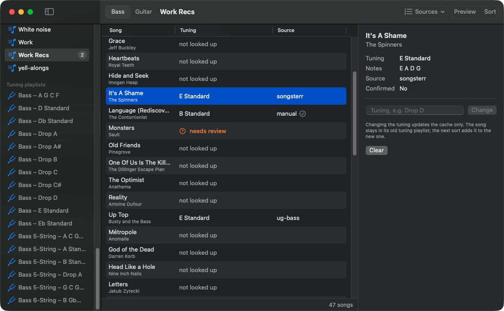

# tune-sort

Sorts an Apple Music playlist into playlists by the tuning a song's bass or guitar is played
in, such as `Bass – Drop D`, `Bass 5-String – B Standard`, `Guitar – Drop C#`,
`Guitar 7-String – B Standard` or `Guitar – Open G`.

Each song's tuning is looked up from public pages, in this order:

| Bass | Guitar |
|---|---|
| 1. Ultimate Guitar: the highest-rated Pro tab whose only instrument is bass | 1. Ultimate Guitar: the highest-rated Pro tab with a guitar part |
| 2. Ultimate Guitar: the highest-rated Bass tab | 2. Ultimate Guitar: the highest-rated guitar Tab |
| 3. Songsterr: the song's bass track | 3. Songsterr: the song's guitar track |

Every source is asked, so Ultimate Guitar's answer is double-checked against Songsterr. If two
sources both match the song exactly but disagree on the tuning, the song goes to a review queue.
Songs that can't be matched exactly go to the review queue too. Answers are cached in
`~/.cache/tune-sort/tunings.db`, separately for bass and guitar, so each song is only looked
up once per instrument.

Running `sort` again is safe. It reuses the existing playlists, never adds a song twice,
and only looks up songs it hasn't seen before. Songs waiting for review aren't looked up
again unless you pass `--recheck`. If a site can't be reached, the song isn't cached or
queued; it shows as `lookup failed` and is tried again on the next `sort`. A song that
can't be added to its playlist (for example one that isn't in your library) is reported
at the end, and the rest are still sorted.

Only macOS is supported, because the app talks to the Music app through `osascript`. It
needs no Apple Developer or Ultimate Guitar account.

## Setup

Needs [uv](https://docs.astral.sh/uv/) (`brew install uv`). It fetches Python 3.12 and the
dependencies:

```bash
uv sync
```

## Usage

Pick the instrument with `bass` or `guitar`:

```bash
uv run tune-sort playlists
uv run tune-sort bass sort "My Playlist" --dry-run     # show what would happen
uv run tune-sort bass sort "My Playlist"               # create playlists and add songs
uv run tune-sort bass review                           # answer songs that couldn't be matched
uv run tune-sort bass set "Nirvana" "Come As You Are" "D Standard"
uv run tune-sort guitar sort "My Playlist"
uv run tune-sort guitar set "Led Zeppelin" "Kashmir" "DADGAD"
```

### Source order

Sources are asked in the order above by default. To change it, create
`~/.config/tune-sort/config.toml` (or point `$TUNE_SORT_CONFIG` at another file):

```toml
[bass]
order = ["songsterr", "ug-bass", "ug-pro"]

[guitar]
order = ["ug-pro", "ug-tab", "songsterr"]
```

The names are `ug-pro`, `ug-bass` (bass) or `ug-tab` (guitar), and `songsterr`. Leave a
name out to stop asking that source. When sources agree, the first one in the order gets the
credit; when they disagree, the review lists them in this order.

`uv run tune-sort config` shows the file in use and each instrument's order.
`--order songsterr,ug-bass` overrides the file for one `sort`, and `--source ug|songsterr|both`
then keeps only the Ultimate Guitar or Songsterr sources. The default is `both`.

While sorting, a spinner shows which song is being looked up (`[3/22] Looking up …`). If
any songs need review at the end, `sort` offers to review them right away (`--review` or
`--no-review` skip the question).

Tunings can be typed as names, for example `Drop D`, `eb standard`, `5-string B Standard`,
`7-string B Standard`, `Open G` or `DADGAD`, or as notes from the lowest string up, for
example `D A D G` or `D A D G B E`. Enharmonic spellings are treated as the same tuning,
so D# G# C# F# and Eb Ab Db Gb both land in `Bass – Eb Standard`. For bass, a 6-string
guitar tuning such as E A D G B E is read as the bass's lowest four strings (E Standard).

## Mac app



TuneSort.app is a window onto the same commands: a sidebar of your playlists (plus Needs
review and All songs), a song table with each song's tuning, and a panel for the selected
song where you can pick a review match, type a tuning, change it or clear it. **Preview**
is a dry run; **Sort** asks before changing Music. Settings (⌘,) holds the source order
per instrument, the repo path and the helper's log.

Building it needs Xcode (for the macOS SDK):

```bash
scripts/build-mac-app        # release build, ad-hoc signed
open mac/TuneSort.app
```

The app lands in `mac/TuneSort.app`; drag it to `/Applications` if you like. It runs the
helper from this repo, at `<repo>/.venv/bin/tune-sort`, so run `uv sync` first. The repo
path defaults to `~/code/tune-sort`; if the helper isn't there the app shows a setup
screen where you can change it (it's also in Settings).

The first time the app reads or changes Music, macOS asks whether TuneSort may control
Music. Allow it. If you said no, the app shows a button that opens System Settings →
Privacy & Security → Automation, where you can turn it back on.

Quitting the app stops the helper; a running sort is cancelled.

For the Swift code in `mac/`: `swift build` and `swift test` from `mac/`. Debug builds
read `TUNESORT_HELPER_ARGS` (space-separated) in place of the helper's `serve` arguments,
for example `serve --cache /tmp/tunings.db --config /tmp/config.toml` to try the app on a
scratch cache.

### Helper for the Mac app

`uv run tune-sort serve` runs the long-lived helper that the TuneSort Mac app drives. It
reads one JSON request per line on stdin (`{"id": 1, "cmd": "hello", "args": {}}`), writes
JSON replies on stdout and exits when stdin closes. Diagnostics go to stderr. It accepts
`--cache PATH` and `--config PATH` like the other commands. The protocol is described in
`docs/superpowers/specs/2026-10-29-mac-app-design.md`.

## Development

```bash
uv run pytest
uv run ruff check src tests
uv run mypy src tests
```
